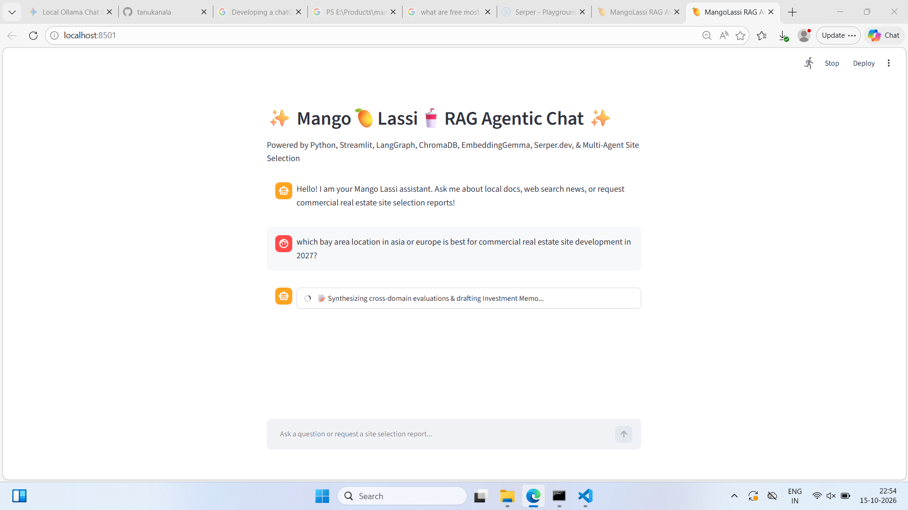
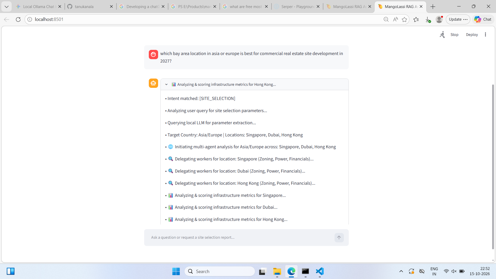
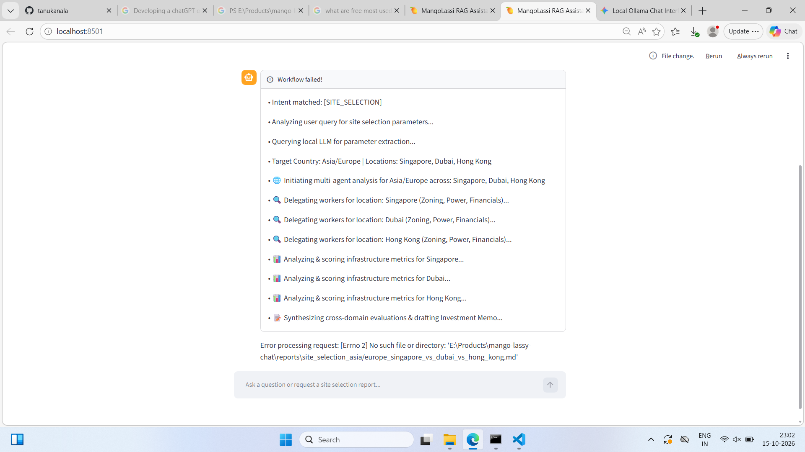
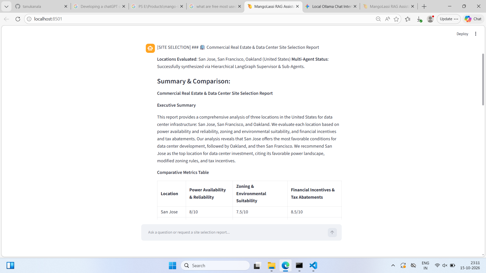
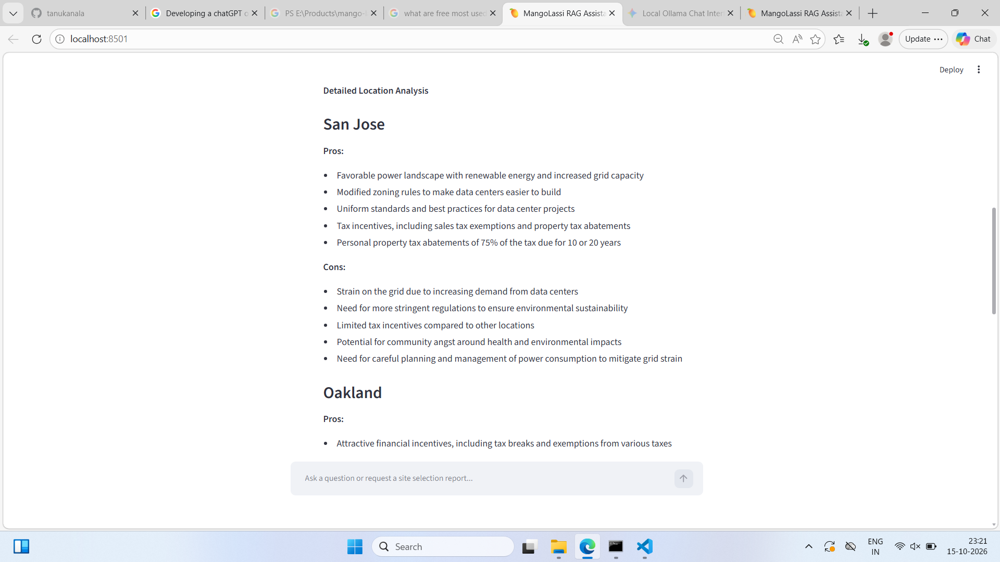
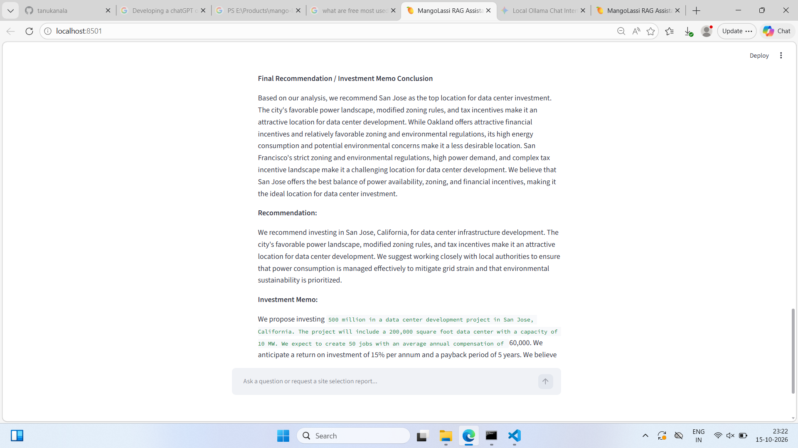

# 🥭 Mango Lassi: Agentic RAG Chat Assistant

**Developed by:** Tanishka Sree Kanala (Tanu)  
**Grade:** 10th Grade, Coppell High School, Dallas, Texas  
**Project Category:** Artificial Intelligence & Software Engineering  

---

## 📌 Project Overview
Mango Lassi is a high-performance, privacy-conscious AI assistant built using modern agentic software architecture. The assistant provides intelligent retrieval-augmented generation (RAG) over local documents, live web search capabilities, and a multi-agent system designed for commercial real estate and infrastructure site selection.

---

## 🚀 Technical Highlights
* **Agentic Graph Workflow (`LangGraph`)**: Implements an adaptive intent router that dynamically directs user queries across four modes: Local Document Retrieval (`[RAG]`), Live Web Search (`[WEB]`), Multi-Agent Site Analysis (`[SITE_SELECTION]`), and General Reasoning (`[LLM]`).
* **Multi-Agent Infrastructure Engine**: Features a supervisor node that delegates research to specialized sub-agents to evaluate zoning, power grid reliability, and tax incentives across global candidate sites.
* **Dual-Layer Guardrails & Privacy**: Applies automated PII (Personally Identifiable Information) sanitization during document ingestion and response generation to protect sensitive user data.
* **In-Chat Telemetry & Streaming UI**: Built with Streamlit, providing real-time execution tracing and workflow status updates (`st.status`) directly within the chat window.

---

## 🛠️ Technology Stack
* **Language & Frameworks**: Python, Streamlit, LangGraph, LangChain
* **AI Models**: Local Ollama (`llama3.2`, `embeddinggemma`)
* **Vector Store**: ChromaDB
* **APIs**: Serper.dev Google Search API Wrapper

## 1. Executive Summary & Project Overview

**Mango Lassi** is an enterprise-grade, privacy-conscious multi-agent AI assistant designed for **Commercial Real Estate (CRE) & Data Center Site Selection**, document-based Retrieval-Augmented Generation (RAG), real-time web search integration, and general AI reasoning.

Built on top of **LangGraph**, **Streamlit**, and local Large Language Models (LLMs) via **Ollama**, Mango Lassi features dual-layer Personally Identifiable Information (PII) guardrails, hierarchical multi-agent graph workflows, and real-time live execution telemetry streamed directly to the user interface.

---

## 2. Key Features

### 🏢 Hierarchical Multi-Agent Site Selection Engine

* **Supervisor-Worker Architecture**: Uses a Lead Investment Director supervisor node that orchestrates parallel research tasks across dedicated sub-agents.
* **Triple-Domain Analysis**: Automatically researches and evaluates candidate sites across three critical vectors:
1. **Zoning & Environmental Regulations**
2. **Power Grid Capacity & Renewable Infrastructure**
3. **Tax Incentives & Financial Abatements**


* **Automated Comparative Reporting**: Synthesizes quantitative scoring (out of 10) and qualitative pros/cons into structured Markdown Investment Memos automatically exported to disk.

### 🎯 Adaptive Ternary Intent Router

* Intelligently inspects incoming user queries and routes them to the optimal execution path:
* **`[SITE_SELECTION]`**: Triggers the multi-agent graph for site analysis and report generation.
* **`[RAG]`**: Queries local vector database for workspace and technical project documentation.
* **`[WEB]`**: Executes live internet searches via Serper.dev for current news, market prices, and dynamic data.
* **`[LLM]`**: Falls back to local general-purpose LLM reasoning.


### 🛡️ Dual-Layer PII Protection (Guardrails)

* **Ingestion Guardrail**: Automatically sanitizes sensitive data (emails, phone numbers, SSNs, names) from local `.txt` and `.md` files prior to chunking and embedding in the vector store.
* **Output Guardrail**: Validates and redacts final AI responses before rendering them in the user interface.

### 📡 Live In-Chat Telemetry & Execution Tracing

* Streams real-time sub-agent execution logs (parameter parsing, worker delegation, scoring, and report saving) directly inside an expandable Streamlit `st.status()` container within the chat bubble.

---

## 3. System Architecture & Tech Stack

### Technology Stack

| Layer | Technology / Library | Purpose |
| --- | --- | --- |
| **User Interface** | Streamlit | Lightweight web interface with `st.status` live telemetry container |
| **Agentic Framework** | LangGraph & LangChain | Graph-based state orchestration and multi-agent coordination |
| **Local LLM & Embeddings** | Ollama (`llama3.2`, `embeddinggemma`) | On-device, privacy-preserving LLM inference and vector embedding generation |
| **Vector Database** | ChromaDB | Local persistent vector database for document chunk retrieval |
| **Search Engine** | Google Serper.dev API Wrapper | Live web search capabilities for real-time site data and news |
| **Security & Privacy** | Custom Presidio / Regex Sanitizer | PII redaction during ingestion and response generation |

---

## 4. Architecture Diagram

```text
                               ┌───────────────────────────┐
                               │   Streamlit UI (`app.py`) │
                               │  - Chat Input / History   │
                               │  - Live st.status() Feed  │
                               └─────────────┬─────────────┘
                                             │ Invokes app_graph.invoke()
                                             ▼
                               ┌───────────────────────────┐
                               │ Main LangGraph StateGraph │
                               │   (State: messages)       │
                               └─────────────┬─────────────┘
                                             │ START
                                             ▼
                               ┌───────────────────────────┐
                               │    `router_agent` Node    │
                               │  (Adaptive Intent Router) │
                               └─────────────┬─────────────┘
                                             │
      ┌──────────────────┬───────────────────┼───────────────────┐
      │                  │                   │                   │
      ▼ [SITE_SELECTION] ▼ [RAG]             ▼ [WEB]             ▼ [LLM]
┌──────────────────┐┌────────────────┐┌────────────────┐┌──────────────────┐
│ site_selector.py ││ ChromaDB +     ││ Google Serper  ││ Direct Ollama    │
│ StateGraph:      ││ EmbeddingGemma ││ API Wrapper    ││ LLM Inference    │
│                  ││ Vector Store   ││ (Live Search)  │└──────────────────┘
│ 1. supervisor    ││ (Guarded Chunks│└────────────────┘          
│    (Serper API)  ││  via Guardrails│                            
│ 2. evaluator     ││  Module)       │                            
│    (LLM Scoring) │└────────────────┘                            
│ 3. synthesizer   │                                              
│    (Markdown Memo│                                              
│     Export)      │                                              
└─────────┬────────┘                                              
          │                                                       
          └──────────────────────────┬────────────────────────────┘
                                     │
                                     ▼
                       ┌───────────────────────────┐
                       │     `guardrail` Node      │
                       │   (Output PII Sanitizer   │
                       │    via `guardrails.py`)   │
                       └─────────────┬─────────────┘
                                     │ END
                                     ▼
                       ┌───────────────────────────┐
                       │ Return AIMessage to UI &  │
                       │ Real-time Telemetry Feed  │
                       │   via `logger.py`         │
                       └───────────────────────────┘

```

---

## 5. Implementation Details & Module Breakdown

The application is architected into decoupled modules for high maintainability, non-circular execution, and clear separation of concerns:

### 1. `app.py` (Presentation & UI Layer)

* Manages Streamlit page configuration, chat history session state (`st.session_state`), and input handling.
* Instantiates an `st.status()` context container that listens to status updates during graph execution and renders progress live to the user.

### 2. `agent_graph.py` (Core Router & Main Graph Orchestration)

* Defines the primary `StateGraph` containing `router_agent` and `guardrail` nodes.
* Initializes and caches the local **ChromaDB** vector store with **EmbeddingGemma**.
* Implements dynamic parameter extraction (`extract_site_parameters`) using `llama3.2` and regex parsing to extract countries and specific target locations from natural language prompts.

### 3. `site_selector.py` (Sub-Graph Multi-Agent Workflow)

* Implements a 3-node sub-graph (`supervisor` $\rightarrow$ `evaluator` $\rightarrow$ `synthesizer`):
1. **Supervisor**: Dispatches parallel search tasks to Serper.dev for each candidate market.
2. **Evaluator**: Prompt-engineers LLM domain experts to score Power, Zoning, and Financials.
3. **Synthesizer**: Constructs the final investment memo, sanitizes filename paths, and exports Markdown reports to `reports/`.

### 4. `guardrails.py` (Privacy & Security Layer)

* Contains the `sanitize_text()` function utilizing Microsoft Presidio / Regex patterns to strip PII before embedding storage and before final UI rendering.

### 5. `logger.py` (Execution Telemetry)

* Acts as a neutral callback bridge between the backend LangGraph workflows and Streamlit UI components, completely avoiding Python circular import issues.

---

How does this project documentation draft look for Tanishka's presentation? Let me know if you would like to expand on any specific section or add performance benchmarking details!

---

## How to Run "Mango Lassi"

### Run Embedding & Llama Models

C:\Users\TEMP\AppData\Roaming\Microsoft\Windows\Start Menu\Programs>ollama run llama3.2

pulling manifest

pulling dde5aa3fc5ff: 100% ▕██████████████████████████████████████████████████████████▏ 2.0 GB

pulling 34bb5ab01051: 100% ▕██████████████████████████████████████████████████████████▏  561 B

verifying sha256 digest

writing manifest

success

> > > Hi
> > 
> 

How can I assist you today?

### Run Streamlit Application

1. open cmd or terminal
2. cd E:\Products\mango-lassy-chat
3. streamlit run app.py

NOTE: Make sure your `.env` file contains your `SERPER_API_KEY`.

3. URL to open from browser:
http://localhost:8501/

### Sample Screens

## Prerequisites

1. **Python 3.10+** installed on your machine (python-3.12.10).
2. **Ollama** installed and running locally with `llama3.2` and `embeddinggemma` pulled.

---

## Install Python

* Install Python: Download and run the official installer from Python.org, ensuring pip is included.
* Add Python to your PATH:
1. Press the Windows key and type environment variables.
2. Click Edit the system environment variables, then click the Environment Variables button.
3. Under System variables or User variables, select Path and click Edit.
4. Add your Python installation directory and Scripts path.


* Restart your terminal: Close your current Command Prompt, PowerShell, or VS Code terminal window and open a fresh one.
* Verify installation: Type the following command to check if it works:

```bash
python --version
pip --version

```

## Install Git

* Step 1: Install Git
If you have not installed Git yet, download and run the installer from the Official Git Website. During setup, make sure to select the option that says "Git from the command line and also from 3rd-party software".
* Step 2: Add Git to your PATH (if already installed)
Add these two paths to your System Environment Variables under Path:
• C:\Program Files\Git\bin
• C:\Program Files\Git\cmd
* Step 3: Restart your terminal
Close your Command Prompt, PowerShell, or terminal window completely and open a new one.
* Step 4: Verify the fix
Type git --version to make sure it works, then run git init inside E:\Products\mango-lassy-chat

## Setup Git for project

1. git init
2. Add a .gitignore file so you don't upload large vector databases or keys

Create a file named .gitignore in the root folder (E:\Products\mango-lassy-chat.gitignore) and paste this inside:

chroma_db/
venv/
.env
__pycache__/

3. git add .
4. git config --global user.email "tanu.kanala@gmail.com"
5. git commit -m "Initial commit: Mango Lassi Python Agentic RAG Chat"
6. git branch -M main
7. git remote add origin [https://github.com/tanukanala/mango-lassy-chat](https://github.com/tanukanala/mango-lassy-chat)
8. git push -u origin main

## Step 1: Project Directory Structure

Create your root folder and subdirectories:

```bash
mkdir mango-lassy-chat
cd mango-lassy-chat
mkdir documents
mkdir reports

```

---

## Step 2: Install Python Dependencies

Setup environment for python. Navigate to your project root and install the required packages:

1. python -m venv venv
2. Set-ExecutionPolicy -ExecutionPolicy RemoteSigned -Scope Process
3. .\venv\Scripts\activate


```bash
pip install -r requirements.txt
python -m spacy download en_core_web_sm

```

---

## LangGraph Architecture Diagram

Here is the accurate, up-to-date architecture diagram reflecting the exact module breakdown, data flows, and routing logic implemented in your code (app.py, agent_graph.py, site_selector.py, guardrails.py, and logger.py):


                               ┌───────────────────────────┐
                               │   Streamlit UI (`app.py`) │
                               │  - Chat Input / History   │
                               │  - Live st.status() Feed  │
                               └─────────────┬─────────────┘
                                             │ Invokes app_graph.invoke()
                                             ▼
                               ┌───────────────────────────┐
                               │ Main LangGraph StateGraph │
                               │   (State: messages)       │
                               └─────────────┬─────────────┘
                                             │ START
                                             ▼
                               ┌───────────────────────────┐
                               │    `router_agent` Node    │
                               │  (Adaptive Intent Router) │
                               └─────────────┬─────────────┘
                                             │
      ┌──────────────────┬───────────────────┼───────────────────┐
      │                  │                   │                   │
      ▼ [SITE_SELECTION] ▼ [RAG]             ▼ [WEB]             ▼ [LLM]
┌──────────────────┐┌────────────────┐┌────────────────┐┌──────────────────┐
│ site_selector.py ││ ChromaDB +     ││ Google Serper  ││ Direct Ollama    │
│ StateGraph:      ││ EmbeddingGemma ││ API Wrapper    ││ LLM Inference    │
│                  ││ Vector Store   ││ (Live Search)  │└──────────────────┘
│ 1. supervisor    ││ (Guarded Chunks│└────────────────┘          
│    (Serper API)  ││  via Guardrails│                            
│ 2. evaluator     ││  Module)       │                            
│    (LLM Scoring) │└────────────────┘                            
│ 3. synthesizer   │                                              
│    (Markdown Memo│                                              
│     Export)      │                                              
└─────────┬────────┘                                              
          │                                                       
          └──────────────────────────┬────────────────────────────┘
                                     │
                                     ▼
                       ┌───────────────────────────┐
                       │     `guardrail` Node      │
                       │   (Output PII Sanitizer   │
                       │    via `guardrails.py`)   │
                       └─────────────┬─────────────┘
                                     │ END
                                     ▼
                       ┌───────────────────────────┐
                       │ Return AIMessage to UI &  │
                       │ Real-time Telemetry Feed  │
                       │   via `logger.py`         │
                       └───────────────────────────┘
Key Components mapped to your code:
app.py: Handles the Streamlit session state, user chat inputs, and the live st.status() container updated via callback hooks.

agent_graph.py: Houses the core state graph, intent routing (route_intent), dynamic parameter extraction, ChromaDB document ingestion (with guardrail checks), and the final guardrail output sanitization node.

site_selector.py: A specialized sub-graph handling hierarchical multi-agent orchestration (supervisor, evaluator, and synthesizer nodes) for Commercial Real Estate and Data Center site analysis and .md file generation.

guardrails.py: Provides text sanitization to protect against PII during file ingestion and final response generation.

logger.py: Acts as a neutral utility to route live execution telemetry directly into the UI without circular imports.

---

## Troubleshooting Model Errors

If you encounter connection or model errors, verify your Ollama status by running:

```bash
ollama list

```

And make sure both models are pulled:

```bash
ollama pull llama3.2
ollama pull embeddinggemma

```

## Sample Screens











